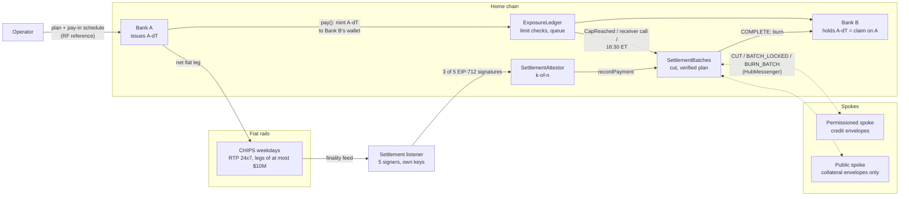

# Interbank credit settlement: a reference model

This repository is a working reference model of an interbank network in which each member bank issues its own
deposit token, and holding another bank's token is credit exposure under limits the members grant each other.
Positions settle net, in fiat, over CHIPS or RTP; an operator's settlement listener attests the rails' own finality
before any token is burned, and the network reaches several chains through hub-and-spoke native burn-and-mint.

It is a model for study and review, not a production system. All banks, tokens, identifiers and routing data in it
are fictional (see [Fictional names](#fictional-names)).

## Status

- **Contracts:** home chain (credit, settlement, default, orderly exit) and cross-chain (hub and spoke messengers,
  spoke exposure guard, remote tokens). 155 Foundry tests in 23 suites, unit, scenario and invariant; every invariant
  suite passes under random seeds. Slither reports no High or Medium findings (four false positives are annotated in
  the source).
- **Back office (Go):** rails simulators, ISO 20022, the k-of-n listener, the operator, three-way reconciliation and
  the cross-chain transport (`internal/xchain`: attesters, issuer co-signers, relayer, cross-chain reconciliation).
- **End-to-end on anvil:** 6 home-chain tests (5 scenarios and a timelock deployment) and 6 three-chain tests
  (X1–X6).
- What the code does not do yet is listed in [design.md §6](docs/design.md#6-known-limits).

## The model

Bank A's customer pays Bank B's customer. Bank A mints its own token, A-dT, into Bank B's settlement wallet. Bank B
now holds a claim on Bank A and credits its customer in its own books. Before anything moves, the contracts check
that claim against the limits the members have granted. Claims build up through the day; at a trigger the operator
cuts a batch, nets every member's position, and the net debtors pay the net creditors in fiat. When the listener
has attested every fiat leg as final, the netted tokens are burned and the exposure is released.



The listener never moves money. It reads the rails' finality events, matches each one to a planned leg by its ISO
11649 reference, and signs. Three of five independent signers must agree before the chain records a payment.

## What makes it safe

| Control | What it does | Where |
|---|---|---|
| Bilateral limits | Each grantor's limit to each debtor = mandatory part (collateral-backed, at most $5M) + elective part (0 to $100M, set by the grantor the same day), capped by any regulatory cap the grantor sets | `CreditLimits.bilateralLimit` |
| Receiver cap and debit cap | A receiver's net position is capped (default $100M); a payer's net debit is capped at the sum of the limits it receives, and at a system maximum ($1bn) | `ExposureLedger.pay`, checks (4) and (5) |
| Queue, not reject | A payment that would breach a limit waits in a FIFO queue and runs when settlement frees headroom | `ExposureLedger.drain` |
| Defaulter-pays collateral | The mandatory limits a bank receives total at most its own attested collateral (the EURO1 rule) | `CreditLimits.mandatory` |
| Cover-2 loss pool | No new cut while the pool is below the attested requirement (the two largest debit caps) | `SettlementBatches.cut` (`PoolNotReplenished`) |
| End-of-day settlement | Every position is cut at 16:30 ET on business days and settled the same day; after the cut, no unsecured credit until the next business window | `internal/operator`, `ExposureLedger` window rule |
| Off-hours prefund rule | Outside the business window a bank may pay on the home chain only within its attested RTP prefund | `ExposureLedger.pay`, check (2) |
| Overnight credit closed on spokes | The operator sets the same window on every spoke; outside it a permissioned spoke takes no payments (`OffHoursCredit`) and its queue does not drain. A public spoke stays open: its envelopes are collateral | `SpokeExposureGuard.setWindow`, `internal/operator` |
| No unwind | No function restores tokens or positions; a missed leg is covered by collateral, then the pool, then the CREDIT-tier survivors; with no eligible survivor the payee bears the rest as a recorded loss | `SettlementBatches`, `DefaultManager` |
| k-of-n listener | 3 of 5 signers, strictly ascending, each with its own key and journal reader; a rail transaction id is usable once, forever; RTP payments over $10M and future finality times are refused | `SettlementAttestor` |
| Two-key cross-chain mints | A mint on another chain needs a strict majority of attesters and the issuing bank's own key | `CrossChainMessenger.receiveMessage` |
| Bounded spokes | Envelopes allocated from the global limits, a per-chain supply cap, an inbound mint rate limit (unset means closed), a global accountant at the hub, restrict-only suspension | `SpokeExposureGuard`, `HubMessenger` |
| Public collateral held to settlement | Collateral behind a public-spoke envelope stays committed from the cut until the batch finalizes, and the default waterfall never draws it | `ExposureLedger.envelopeToPending`, `clearPending`; `DefaultManager` |

## Economics, stated plainly

The simulator in `internal/econ` runs the same synthetic flows through gross settlement, prefunded netting and this
model. Full method and tables: [docs/economics.md](docs/economics.md).

- **This model does not beat queued prefunded netting on liquidity in these runs.** Its opening-balance need is
  about the same as release-on-submission netting and 29–38% above a queued, CHIPS-like design, at every bank count
  tried (10, 20, 40). On top of that it ties up collateral and a loss pool: $1.1bn at 10 banks, $9.4bn at 40.
- **Why.** Payment sizes are heavy-tailed. With $5M mandatory limits and elective limits sized to a tenth of a day's
  bilateral flow, 19–30% of the value is in payments larger than any limit, which this model pays gross. Raising
  the elective limits moves value onto the ledger but raises the debit caps, and with them the cover-2 pool.
- **Where the value lies instead.** Credit available 24x7 within prefund envelopes, with RTP settlement outside
  CHIPS hours; programmable, final-on-check token transfers (for example delivery versus payment on another chain);
  an auditable many-to-one mapping from token transfers to fiat legs (every fiat payment carries its batch's RF
  reference, and every batch records the hash chain of the home-chain payments and moves it settles); and reach to
  several chains without wrapped tokens. Whether these are worth the collateral is a business question the numbers
  do not answer.

The flows are synthetic and uncalibrated; they show how the designs respond, not what any real network would need.

## Quick start

Requirements: Go 1.26, and Foundry (forge, anvil) either installed or through Docker.

**Contracts.** Dependencies are pinned in `contracts/foundry.toml` and restored by soldeer.

```sh
cd contracts
forge soldeer install
forge build
forge test
```

Without a local Foundry, the same through Docker:

```sh
cd contracts
docker run --rm -u "$(id -u):$(id -g)" -e HOME=/tmp -v "$PWD":/w -w /w \
  ghcr.io/foundry-rs/foundry:stable "forge soldeer install && forge build && forge test"
```

**Go.** The end-to-end tests start anvil and deploy the compiled contracts (`contracts/out`, or `$ICS_ARTIFACTS`).
They skip when no anvil is found. The home-chain tests (`TestE2E_*`, `TestDeployTimelockMode`) use one anvil; the
cross-chain tests (`TestXChain_X1`…`X6`) start three, for the home chain, a permissioned spoke and a public spoke. To
use the anvil from the Docker image:

```sh
mkdir -p bin
docker create --name foundry-tmp ghcr.io/foundry-rs/foundry:stable
docker cp foundry-tmp:/usr/local/bin/anvil bin/anvil
docker rm foundry-tmp

ANVIL_BIN=$PWD/bin/anvil go test ./... -count=1
ANVIL_BIN=$PWD/bin/anvil go test ./internal/e2e -run TestXChain -count=1 -v   # the three-chain tests only
```

**Narrated demo.** A Friday, a weekend, a Monday holiday and the next business day, with three banks, the operator
and the five-signer listener, ending in a table of every batch:

```sh
ANVIL_BIN=$PWD/bin/anvil go run ./cmd/operator-demo          # -quiet prints only the summary
```

**Economics.** Reproduces the tables in [docs/economics.md](docs/economics.md) (about 8 s):

```sh
go run ./cmd/econ                     # N = 10, 20, 40
go run ./cmd/econ -h                  # parameters
```

## Repository layout

| Path | Contents |
|---|---|
| `contracts/src/credit/` | Home chain: `MemberRegistry`, `ObligationToken`, `CollateralRegister`, `CreditLimits`, `ExposureLedger`, `SettlementAttestor`, `SettlementBatches`, `DefaultManager`, `RfReference` |
| `contracts/src/crosschain/` | `CrossChainMessenger` (shared base), `HubMessenger`, `SpokeMessenger`, `SpokeExposureGuard`, `RemoteObligationToken` |
| `contracts/src/interfaces/` | One interface per contract, with its events and errors |
| `contracts/script/` | `DeployHome`, `DeployRemote`: every contract administered by a timelock; the deployer keeps no role |
| `contracts/test/` | Unit, scenario and invariant (fuzz) tests for the home chain and the cross-chain contracts |
| `internal/calendar` | US Eastern time, Federal Reserve holidays, CHIPS and Fedwire hours, the model's business window |
| `internal/rails` | CHIPS and RTP simulators with append-only journals and finality feeds |
| `internal/iso20022` | pacs.008, pacs.009 and camt.054 with the ISO 11649 batch reference and the EndToEndId scheme |
| `internal/listener` | Matching, EIP-712 signing, the k-of-n aggregator, funding attestations |
| `internal/operator` | Business window (home and spokes), cut triggers, plan builder, rail choice, pay-in schedule, default path |
| `internal/reconcile` | Three-way reconciliation (rail journals, listener log, chain) that halts new cuts on a break |
| `internal/chain`, `internal/deploy` | Chain client and deployment of the home and spoke contracts from the Foundry artifacts |
| `internal/xchain` | Cross-chain transport: five attesters, each on its own connections and waiting for finality per chain; per-bank issuer co-signers; an untrusted, replay-safe relayer with rate-limit retry and deadline cancel; cross-chain reconciliation |
| `internal/e2e` | anvil harness and end-to-end tests. Home chain: cap trigger over CHIPS, end of day, Saturday over RTP, faults, default, timelock deployment. Three chains: X1 a cut across chains, X2 lock-then-burn moves, X3 faults, X4 suspension, X5 a spoke-only day, X6 spoke off-hours |
| `internal/econ`, `cmd/econ` | Economics simulator |
| `cmd/operator-demo` | Narrated demo |

## Documentation

| Document | For | Contents |
|---|---|---|
| [docs/business-flows.md](docs/business-flows.md) | Payments, treasury, risk | Every flow step by step: who acts, which call, which check, the effect |
| [docs/rulebook-term-sheet.md](docs/rulebook-term-sheet.md) | Risk, legal, governance | The rules the contracts enforce and their parameters, as a term sheet |
| [docs/regulatory-map.md](docs/regulatory-map.md) | Regulators, legal, risk | Each design choice against the PFMI, Federal Reserve policy and US law, and the open legal questions |
| [docs/cross-chain.md](docs/cross-chain.md) | Engineers, risk | Hub and spoke, two-key mints, envelopes, lock-then-burn, bounds, incident lessons |
| [docs/design.md](docs/design.md) | Engineers | The normative specification of the contracts and the back office, with known limits |
| [docs/economics.md](docs/economics.md) | Everyone | Liquidity of three settlement designs on synthetic flows |

## Fictional names

Bank A, Bank B and Bank C, their tokens A-dT, B-dT and C-dT, the member ids `BNKAUS30`, `BNKBUS30` and `BNKCUS30`,
and every account number and routing value in this repository are invented. "The operator" and "the settlement
listener" are roles in the model, not organisations. CHIPS, RTP, Fedwire and FedNow are named because they are
public payment rails whose published rules the model follows. Systems such as EURO1 or pre-2001 CHIPS appear only as
precedents, with citations. Nothing here describes, or is endorsed by, any real institution.
