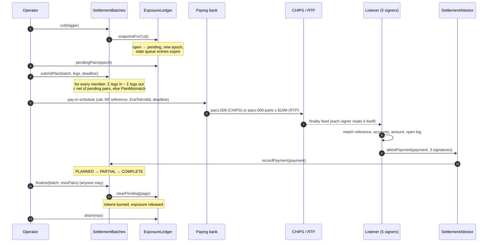
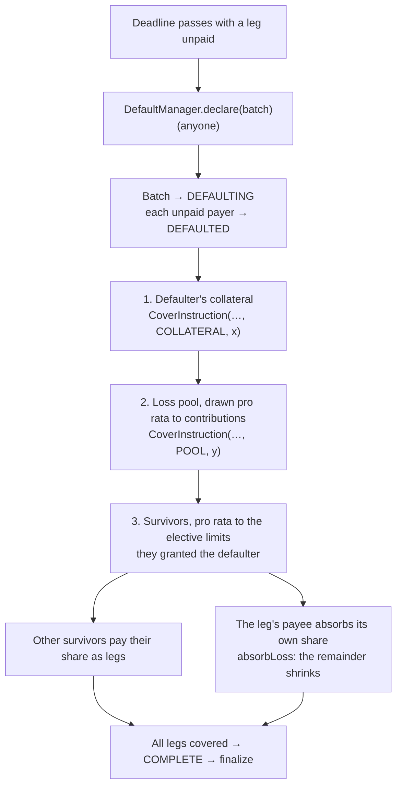

# Business flows

This document walks through every flow of the model: who acts, which contract call they make, which check runs and
what changes. The normative detail is in [design.md](design.md); the parameters are in
[rulebook-term-sheet.md](rulebook-term-sheet.md). All names are fictional: Bank A, B and C issue A-dT, B-dT and C-dT.

Amounts are in US dollars. On chain they have 6 decimals (1 USD = 1_000_000).

## Contents

1. [Actors and keys](#1-actors-and-keys)
2. [A payment](#2-a-payment)
3. [The queue](#3-the-queue)
4. [Settlement: the common path](#4-settlement-the-common-path)
5. [Cap trigger](#5-cap-trigger)
6. [Receiver call](#6-receiver-call)
7. [End of day](#7-end-of-day)
8. [Off-hours and weekends: RTP within prefund](#8-off-hours-and-weekends-rtp-within-prefund)
9. [Partial settlement](#9-partial-settlement)
10. [Overpayment](#10-overpayment)
11. [Faults](#11-faults)
12. [Default and the waterfall](#12-default-and-the-waterfall)
13. [Cutting limits: PCA, supervisory triggers, SCCL and Regulation F headroom](#13-cutting-limits-pca-supervisory-triggers-sccl-and-regulation-f-headroom)
14. [The prefund-only tier](#14-the-prefund-only-tier)
15. [Cross-chain flows](#15-cross-chain-flows)

## 1. Actors and keys

| Actor | Key or contract | What it may do |
|---|---|---|
| Member bank, as payer and grantor | `issuerOps` key | `pay`, `cancel` a queued payment, `requestSettlement`, set its elective limits and regulatory caps, lower its receiver cap |
| Member bank, as holder | settlement `wallet` | Holds other banks' tokens; starts a cross-chain move of tokens it holds (`sendMint`) |
| Member bank, as issuer | issuer key on each messenger | Co-signs every cross-chain mint of its own token |
| The operator | `OPERATOR_ROLE` | Sets the business window and business day, cuts batches, submits plans, issues pay-in schedules, grants and releases spoke envelopes, may restrict a debtor's mandatory limits |
| The settlement listener | 5 signer keys (k = 3) | Signs EIP-712 attestations of final rail payments and of funding values |
| Cross-chain attesters | attester keys on each messenger (strict majority) | Sign cross-chain messages after source-chain finality |
| Guardian | `GUARDIAN_ROLE` | Fast, restrict-only actions: suspend a member, restrict mandatory limits, freeze or pause tokens, disable a signer or attester, lower supply caps and rate limits, disconnect a spoke |
| Governance | `DEFAULT_ADMIN_ROLE`, held by a `TimelockController` | Admits members, sets parameters, changes signer sets and thresholds, reinstates, raises anything |
| Anyone | no role | `drain` the queue, `finalize` a completed batch, `declare` a default after the deadline, deliver attested cross-chain messages, `sendBurns`, `cancelExpired` |

The rails (CHIPS, RTP, and Fedwire for RTP funding) are outside the chain. The operator never holds money; the
banks pay each other directly on the rails.

## 2. A payment

A customer of Bank A pays a customer of Bank B $2M.

| Step | Who | Call | Check | Effect |
|---|---|---|---|---|
| 1 | Bank A | `ExposureLedger.pay(to = BNKBUS30, amount, ref)` from A's `issuerOps` | (1) A and B in good standing, distinct, amount > 0 | Reverts otherwise: `NotIssuerOps`, `ZeroAmount`, `SelfPayment`, `PayerNotInGoodStanding`, `PayeeNotInGoodStanding` |
| 2 | ledger | | (2) window: in `OFF_HOURS`, A's off-hours total plus this amount must not exceed A's attested RTP prefund | Reverts `OffHoursPrefundExceeded` otherwise |
| 3 | ledger | | (3) B's bilateral net exposure to A after the payment ≤ `bilateralLimit(B, A)`; (4) B's net position ≤ B's receiver cap; (5) A's net debit ≤ A's debit cap | If any fails, the payment is **queued**, not rejected: `Queued(seq, reason)` with reason 3, 4 or 5 |
| 4 | ledger | `ObligationToken(A).mint(B.wallet, amount)` | | B's wallet holds 2M A-dT. `open[A][B]` grows by 2M. The epoch hash commits to `(seq, payer, payee, amount, ref)`. `Paid(seq, A, B, amount, ref)` |
| 5 | ledger | | B's net position ≥ its trigger level (default 100% of the receiver cap) | `CapReached(B)`: the operator's cut trigger (§5) |
| 6 | Bank B | off chain | | Credits its customer. The token transfer is final: nothing on chain can reverse it |

Bank B now holds a claim on Bank A. Tokens cannot be transferred onward: `transfer` and `transferFrom` revert
`TransfersDisabled()` unless the caller is the cross-chain messenger, and `approve` reverts for any spender other
than the messenger (see §15). So B's exposure to A is exactly what B holds of A-dT, net of what A holds of B-dT.

Anyone may ask the ledger in advance with the view `check(payer, to, amount)`, which returns 0 or the number of the
first failing check.

## 3. The queue

| Event | Call | Effect |
|---|---|---|
| A payment fails checks (3)–(5) | `pay` | Entry appended to a FIFO queue with its business day |
| Headroom frees up (usually after a batch finalizes) | `drain(max)`, anyone; the operator calls it after each batch | Retries from the head. Stops at the first entry that still fails, or whose token is paused or recipient frozen, or that the window rule blocks. Cancels (`QueueCancelled`, reason 1) entries whose payer or payee is no longer in good standing |
| The payer changes its mind | `cancel(seq)` from the payer's `issuerOps` | `QueueCancelled`, reason 0 |
| A new business day's first cut | inside `cut` → `snapshotForCut` | Every queued entry from an earlier business day is expired (`QueueExpired`). Nothing queued carries into a new business day |

Order is strict FIFO across all payers: one stuck payment at the head holds the ones behind it.

## 4. Settlement: the common path

Every batch, whatever triggered it, follows the same path.

**Cut.** `SettlementBatches.cut(trigger)` by the operator; trigger 1 = CAP, 2 = RECEIVER_CALL, 3 = END_OF_DAY.
It reverts `BatchOutstanding` while the previous batch is not finalized (one batch in flight), and
`PoolNotReplenished` while the loss pool is below its attested requirement. The ledger moves every open position
into `pending` for the batch and starts a new epoch; payments continue at once against the new epoch, with the
pending amounts still counted as exposure. The operator skips a cut when the open epoch has no payments.

**Plan.** The operator nets each member's position over the batch's pending pairs and pays net debtors to net
creditors, largest first: at most (members − 1) legs (`operator.BuildPlan`). `submitPlan(batch, legs, deadline)`
accepts the plan only if, for every member, the legs it receives minus the legs it pays equal its net position;
otherwise it reverts `PlanMismatch(member)`. The deadline must be in the future. A batch with no legs (all positions
offset) completes at once.

**Rail and deadline.** The operator uses CHIPS while the CHIPS session is open with at least 15 minutes left before
its 17:00 ET cut-off; the pay-in deadline is one hour after the plan, capped at 17:00 ET. Otherwise it uses RTP:
each leg is split into payments of at most $10M, deadline one hour after the plan.

**Reference.** Every payment carries the batch's ISO 11649 creditor reference, `rfReference(batch)` = "RF" + check
digits + "CS" + batch number, and an EndToEndId `CS<batch>-L<leg>-<part>` (at most 35 characters). On CHIPS the
message is a pacs.009 (the reference in the unstructured remittance line); on RTP a pacs.008 (the reference in
`RmtInf/Strd/CdtrRefInf/Ref`).

**Attestation.** Each of the five listener signers reads the rail journals itself and signs only an entry that is a
final payment, carries a reference that parses to an open leg, whose message agrees with the rail entry, whose payer
account belongs to the leg's payer (or an allowed waterfall payer) and payee account to the leg's payee, and that it
has not signed before. Anything else goes to manual review; nothing is signed for it. Three matching signatures are
submitted to `SettlementAttestor.attestPayment`.

**Recording.** `recordPayment` adds the amount to the leg. A leg is paid when `paid ≥ amount`. The batch goes
`PLANNED → PARTIAL` on the first payment that does not complete it, and `COMPLETE` when every leg is paid.

**Finality and release.** `finalize(batch, maxPairs)`, callable by anyone once the batch is `COMPLETE`, pages
through the pending pairs: the ledger clears each pair's pending amount and the batch burns the holder's tokens of
that issuer. Exposure is released only here. Pairs locked on spokes are burned there (§15.6). When the last page is
done the batch is finalized and the next cut may run. The operator then drains the queue and runs the three-way
reconciliation.

**No unwind.** No function restores tokens or positions. The only way out of `PLANNED` is completion, by the debtor
or by the default waterfall (§12).

## 5. Cap trigger

| Step | Who | What |
|---|---|---|
| 1 | Bank B | Receives payments until its net position reaches its trigger level |
| 2 | ledger | Emits `CapReached(B)` in the payment that crossed it |
| 3 | Operator | Sees the event and cuts with trigger 1 (CAP); the common path follows |
| 4 | Payers | A payment that would take B above its receiver cap queues (check 4) until the batch finalizes and the queue drains |

The trigger level is `receiverCap × triggerBps / 10_000`, default 100%. Governance may lower it so that the cut
starts before payments to B begin to queue.

## 6. Receiver call

Any member in good standing may ask for early settlement, for instance when it wants its exposure down before a
scheduled event.

| Step | Who | Call | Effect |
|---|---|---|---|
| 1 | Bank B | `SettlementBatches.requestSettlement()` from B's `issuerOps` | `SettlementRequested(B)`; reverts `NotInGoodStanding` for a member not in good standing |
| 2 | Operator | `cut(2)` | Common path |

If a batch is already in flight the operator keeps the trigger and cuts as soon as that batch is finalized.

## 7. End of day

| Time (ET) | Who | What |
|---|---|---|
| 16:30, business day | Operator | `setWindow(OFF_HOURS)` and an END_OF_DAY cut (trigger 3). From here on payments need RTP prefund (§8): no unsecured credit is taken after the cut |
| 16:30–17:00 | Debtors | Pay their legs over CHIPS; the deadline is 17:00 ET, the CHIPS payment cut-off |
| by 17:00 | Listener, anyone | Attest, record, finalize: every position taken in the business window is settled the same business day |
| after 17:00 | Anyone | If a leg is still unpaid, `DefaultManager.declare(batch)` (§12) |
| 21:00, evening before the next business day | Operator | `setBusinessDay(yyyymmdd)` and `setWindow(BUSINESS)`; the off-hours allowance resets |

A batch still in flight at 16:30 completes first; the END_OF_DAY cut then takes everything left. Queued payments
from the day are expired at the next business day's first cut (§3); a bank that still wants to pay them pays again,
or pays gross outside the ledger.

## 8. Off-hours and weekends: RTP within prefund

Outside the business window (after 16:30 ET, weekends, Federal Reserve holidays) there is no unsecured credit. A bank
may pay only within the RTP prefund it has placed in the RTP joint account and that the listener has attested.

| Step | Who | Call | Check or effect |
|---|---|---|---|
| Friday, Fedwire open | Bank A | Funds its RTP position over Fedwire | Fedwire funds runs 21:00 ET the previous day to 19:00 ET on business days only |
| | Listener | `SettlementAttestor.attestFunding(Funding{kind: 2 RTP_PREFUND, member, value, asOf, nonce}, sigs)` | Each signer checks the value against its own view of the RTP position; 3 of 5 sign; `asOf` must be later than the last attestation of that kind for that member |
| Saturday | Bank A | `pay(B, amount, ref)` | Check (2): A's off-hours total for this session plus `amount` ≤ A's attested RTP prefund; otherwise reverts `OffHoursPrefundExceeded`. Checks (3)–(5) still apply |
| | Operator | cut on a trigger, plan, pay-in schedule on RTP | Legs split into payments of at most $10M; the pay-in deadline is one hour after the plan |
| | Bank A | pays the parts on RTP | RTP is 24x7; each payment is final when it posts |
| | Listener, anyone | attest, record, finalize | As on a weekday |
| Sunday 21:00 (Monday a business day) | Operator | `setWindow(BUSINESS)` | The off-hours allowance resets |

The off-hours allowance counts gross payments made in the session and is not reduced by settlements within it, so a
bank cannot pay more than its prefund in one off-hours session even if it is also receiving. The rulebook earmarks
the attested prefund for settling those payments; the chain does not hold the money.

## 9. Partial settlement

An RTP leg of $35M is four payments: $10M, $10M, $10M and $5M. After the first is attested the batch is `PARTIAL`;
the leg shows `paid = 10M`. Nothing is burned and no exposure is released until every leg of the batch is paid in
full: the chain never burns in proportion to a part payment. The same applies to a CHIPS leg paid in several
messages. A leg paid short at the deadline is a default (§12) for the remainder only; what was paid counts.

## 10. Overpayment

If a leg receives more than its amount (a duplicate instruction executed twice by the bank, for example), each
payment is still a distinct final rail transaction and is recorded. `overpaid[batch][leg]` holds the excess and
`Overpaid(batch, leg, excess)` is emitted. The operator refunds the excess off chain. Nothing is unwound and the
batch is unaffected.

## 11. Faults

| Fault | What stops it | Result |
|---|---|---|
| The rail feed delivers the same payment twice | Each signer remembers what it signed; on chain `usedRailTx[railTxId]` is set at the first attestation and `RailTxUsed` refuses any second one | Attested once |
| A bank copies another bank's reference onto its own payment | The payer account does not belong to the leg's payer: signers refuse (`ErrPayerMismatch`); on chain `WrongPayer` | Manual review; the leg stays unpaid |
| Payment to the wrong payee, or for a different amount than its message says | Signers refuse (`ErrPayeeMismatch`, `ErrMessageMismatch`); on chain `WrongPayee` | Manual review |
| A payment arrives after its batch completed, or names no open leg | Signers refuse (`ErrNoOpenLeg`) | Manual review; refund off chain |
| An RTP camt.056 return request | Not a payment: signers skip it | Changes nothing. A return that actually settles is a new payment, handled under governance |
| A forged attestation, or an RTP payment over $10M, or one claimed final in the future | `SettlementAttestor`: fewer than k signatures, unknown or disabled signer, duplicate or unsorted signatures, `RtpLimitExceeded`, `FinalAtInFuture` | Refused |
| A signer key is compromised | Guardian `disableSigner(signer)` at once (k must stay reachable); governance replaces it through the timelock | One key alone can sign nothing |
| The rail journals, the listener's log and the chain disagree | Three-way reconciliation after every finalized batch | The operator halts new cuts until the break is resolved; payments within limits continue |
| The loss pool is below its attested requirement | `cut` reverts `PoolNotReplenished` | No new batch until members replenish (§12) |

## 12. Default and the waterfall

A debtor misses the pay-in deadline.

| Step | Who | Call | Effect |
|---|---|---|---|
| 1 | Anyone (the operator does it automatically) | `DefaultManager.declare(batch)` | Reverts `NotDeclarable` unless the batch is `PLANNED` or `PARTIAL`, and `DeadlineNotPassed` until the deadline has passed. The batch becomes `DEFAULTING`. Every member that is payer of an unpaid leg becomes `DEFAULTED` |
| 2 | DefaultManager | `CollateralRegister.drawCollateral` | For each unpaid remainder: the defaulter's attested collateral first (`CoverInstruction(batch, leg, COLLATERAL, x)`) |
| 3 | DefaultManager | `CollateralRegister.drawPool` | Then the pool, drawn from every contributor pro rata to its share (`CoverInstruction(…, POOL, y)`) |
| 4 | DefaultManager | | Then the survivors: every admitted member that is `ACTIVE` or `SUSPENDED`, other than the defaulter, pro rata to the elective limit it granted the defaulter; equal weights if all those limits are 0; the rounding remainder to the first survivor with the largest weight. Reverts `NoSurvivors` if there are none |
| 5 | DefaultManager | `SettlementBatches.absorbLoss` | The leg's payee is never asked to pay itself: its own share is booked as absorbed and the leg's remainder shrinks by it |
| 6 | Operator | pay-in instructions | COLLATERAL and POOL pay from their sub-accounts of the joint account; each other survivor pays its share. Each payment is attested with `payer` = `COLLATERAL`, `POOL` or the survivor, which `recordPayment` accepts because the default manager allowed that payer for that leg |
| 7 | Anyone | `finalize` | When every leg is covered the batch is `COMPLETE` and finalizes as usual |
| 8 | Listener | `attestFunding(kind 1 POOL, …)` | Members replenish the pool; `cut` stays blocked until `poolTotal ≥ poolRequired` |
| 9 | Operator | `HubMessenger.sendSuspend(member)` | Spokes suspend the defaulter (§15.7) |

`DEFAULTED` is terminal: no function reinstates a defaulted member. It cannot pay or receive, its limits are 0, and
queued payments to or from it are cancelled when `drain` reaches them. The tokens it already issued stay final in their
holders' wallets until the waterfall's fiat payments settle them. Cover payments have no on-chain deadline.

## 13. Cutting limits: PCA, supervisory triggers, SCCL and Regulation F headroom

A member must be able to cut its exposure to a weakening counterparty without making a fresh bilateral credit
decision, and must never be forced over a regulatory limit. Every change below takes effect for the next payment;
none affects exposure already taken (that settles at the next cut, which the member can request at once, §6).

| Situation | Who | Call | Effect |
|---|---|---|---|
| A debtor falls into a prompt-corrective-action category, or a supervisory event occurs | Guardian or operator | `CreditLimits.restrict(debtor)` | The debtor's mandatory limit from every grantor is 0 at once. Only governance can `unrestrict` |
| Serious concern about a member | Guardian | `MemberRegistry.suspend(id, reason)` | Not in good standing: cannot pay or receive; every limit to or from it is 0. Governance may `reinstate` |
| A grantor nears its SCCL limit, or its Regulation F policy requires a lower exposure | Grantor's `issuerOps` | `setRegCap(debtor, cap, reason)` | The grantor's bilateral limit to that debtor becomes at most `cap`, mandatory part included; the reason code is logged. `clearRegCap(debtor, reason)` lifts it |
| A grantor changes its credit appetite | Grantor's `issuerOps` | `setElective(debtor, amount)` | Same-day change, 0 to `electiveMax` ($100M) |
| A receiver wants to hold less in total | Receiver's `issuerOps` | `lowerReceiverCap(cap)` | Only downwards (`CanOnlyLower`); governance may set any value |
| Members decide to remove forced credit altogether | Governance (majority, through the timelock) | `setMandatoryRemoved(true)` | Mandatory limits are 0 for everyone |
| A debtor's collateral falls | Listener | `attestFunding(kind 0 COLLATERAL, …)` | The mandatory limit it receives shrinks with it: min($5M, free collateral / (credit members − 1)) |

## 14. The prefund-only tier

Smaller banks may join without taking part in mutual credit.

| Aspect | Rule (code) |
|---|---|
| Admission | `MemberRegistry.admit(id, wallet, issuerOps, token, Tier.PREFUND_ONLY)` by governance |
| Mandatory limits | Neither grants nor receives them; it does not count in the credit-member denominator of the mandatory formula |
| As payer | Check (3), the bilateral limit, does not apply: its debit cap is its own free collateral, `collateral − collateralCommitted`, capped by the system maximum. Checks (2), (4) and (5) apply |
| As receiver | Holds other banks' tokens only within the elective limits it grants them |
| Off hours | Same RTP prefund rule as everyone |
| Default | Same declaration; its collateral covers first |

One rule of the current code needs attention: when no survivor granted the defaulter any elective limit, the
survivor shares fall back to equal weights across every `ACTIVE` or `SUSPENDED` member, prefund-only members included.
See the known limits in [design.md](design.md#6-known-limits).

## 15. Cross-chain flows

Spokes are other chains connected only to the home chain (the hub). Messages between them are attested by a strict
majority of the operator's attesters after source-chain finality; a mint also needs the issuing bank's own key.
Anyone may carry a signed message and call `receiveMessage(message, attesterSigs, issuerSig)` on the destination.
Detail and rationale: [cross-chain.md](cross-chain.md).

### 15.1 Envelope grant

Credit on a spoke is a slice ("envelope") of the global limits, reserved at the hub first.

| Step | Who | Call | Check or effect |
|---|---|---|---|
| 1 | Operator | `HubMessenger.grantEnvelope(domain, issuer, holder, amount)` | `NotASpoke` for an unknown domain |
| 2 | Hub ledger | `reserveEnvelope` | Permissioned spoke: issuer and holder in good standing, and checks (3)–(5) as if `amount` were paid now; a failure reverts (`BilateralLimitExceeded`, `ReceiverCapExceeded`, `DebitCapExceeded`). Public spoke: the amount is committed from the issuer's free collateral (`InsufficientFreeCollateral`) |
| 3 | Hub | `ENVELOPE_GRANT` message | The reservation counts as exposure at the hub from now on, as if fully used |
| 4 | Spoke | `SpokeExposureGuard.grant` | `env[issuer][holder]` rises. For an unknown or suspended pair nothing rises: the amount is parked as `releasable` |

### 15.2 Envelope release

| Step | Who | Call | Effect |
|---|---|---|---|
| 1 | Operator on the spoke | `SpokeMessenger.releaseEnvelope(issuer, holder, amount)` | Lowered on the spoke first: parked amounts first, then unused envelope (`ReleaseExceedsFree` otherwise) |
| 2 | Spoke | `ENVELOPE_RELEASE` message | |
| 3 | Hub ledger | `releaseEnvelope` | The reservation (and, on a public spoke, the collateral commitment) falls |

### 15.3 A payment on a spoke

| Step | Who | Call | Check or effect |
|---|---|---|---|
| 1 | Bank A, its `issuerOps` on that chain | `SpokeExposureGuard.pay(to, amount, ref)` | Reverts for an unknown or suspended member, a paused token or frozen recipient |
| 2 | guard | | `used + amount ≤ env` for the pair, and the issuer's supply cap on that chain; otherwise queued locally (reason 1 envelope, 2 supply cap) |
| 3 | guard | `RemoteObligationToken(A).mint(B.wallet, amount)` | `used[A][B]` rises. The exposure was already counted at the hub when the envelope was granted |

### 15.4 A DvP-like payment on a public spoke

A public chain carries assets the banks' customers trade. Credit is never extended there: an envelope on a public
spoke is backed one-for-one by the issuer's collateral.

| Step | Who | What |
|---|---|---|
| 1 | Operator | Grants Bank A → Bank B an envelope of $20M on the public spoke; $20M of A's free collateral is committed |
| 2 | Bank B's customer | Sells a bond to Bank A's customer; B's wallet escrows the bond in a DvP agent contract |
| 3 | Bank A | Its payment key on that chain is the DvP agent. Settling the deal calls `guard.pay(B, price, ref)` and delivers the bond in the same transaction |
| 4 | DvP agent | If the payment would queue (envelope or supply cap), the agent reverts: no delivery without payment |
| 5 | Operator | The position settles at the next cut like any other (§15.6) |

This is the scenario in `test_10_dvpOnPublicSpoke_paidFromCollateralEnvelope`; the agent is a test contract
(`DvpAgent`), not part of the model's contracts.

### 15.5 Moving tokens between chains

A holder may move tokens it holds between home and a spoke. Exposure does not change: at the hub the moved amount
passes between the holder's open position and its envelope for that spoke.

**Home → spoke.** The holder's wallet approves the hub messenger and calls
`HubMessenger.sendMint(issuer, holder, amount, dest, recipient, deadline)`. The hub takes the tokens into escrow
(lock), `moveOut` turns that much of the open position into envelope for the spoke (a public spoke also commits
collateral), and `sent[issuer][dest]` rises. The spoke checks the mint (known, not suspended, recipient = holder's
wallet there, not blocked, within the supply cap) and, if it passes and the inbound rate limit allows, mints and
replies `MINT_ACK`; the hub then burns the escrowed tokens. If the spoke refuses, it replies `MINT_CANCEL` and the hub
returns the tokens and the position. If the inbound rate limit is exhausted (or was never set), the delivery reverts
and the same message can be delivered again later; it is not cancelled.

**Spoke → home.** The holder's wallet calls `SpokeMessenger.sendMint(…, dest = home, …)`. The guard locks the tokens
and takes them out of the spoke's open position and envelope. The hub checks: recipient = holder's home wallet, token
not blocked, `returned + amount ≤ sent` for that issuer and spoke (the global accountant), the spoke's envelope covers
the amount, and, for a public spoke, that credit checks (3)–(5) hold at home. On success it mints at home through the
ledger (`moveIn`) and replies `MINT_ACK`; the spoke burns the locked tokens. On refusal, `MINT_CANCEL` unlocks them.

**Timeout.** If a mint has not landed by its deadline, anyone may call `cancelExpired(message, attesterSigs)` on the
destination. The nonce is marked cancelled for good (it can never mint afterwards) and `MINT_CANCEL` goes back to the
source, which unlocks. Only the attesters' signatures are needed: cancelling creates nothing.

A token is never burned at the source before its mint is proven, and never minted twice.

### 15.6 Cut, lock and burn across chains

| Step | Who | What |
|---|---|---|
| 1 | Operator | `cut(trigger)` at home; the batch calls `HubMessenger.broadcastCut(epoch)`, which sends `CUT` to every connected spoke |
| 2 | Each spoke | `guard.cut(epoch)`: every nonzero `used` is locked in the holder's wallet and taken out of both `used` and `env`. One `BATCH_LOCKED` per pair, then a terminator with zero ids carrying the pair count |
| 3 | Hub | Each pair moves from the spoke's envelope into the batch's pending (`envelopeToPending`, `addRemoteToBatch`) |
| 4 | Operator | `submitPlan` succeeds only once every connected spoke has reported in full (`SpokesNotReported` before); one plan covers home and spokes |
| 5 | Banks, listener | Fiat legs and attestation as on the common path: one fiat payment can settle tokens on three chains |
| 6 | Anyone | `finalize` at home; then `HubMessenger.sendBurns(epoch)` sends one `BURN_BATCH` per spoke pair, once |
| 7 | Each spoke | `burnBatch` burns exactly the locked amount. Until it lands the tokens are settled-pending-burn: locked, unusable, only burnable |

The cut consumes the spoke envelope: after settlement the operator grants a fresh envelope if the pair needs one.

### 15.7 Suspension

| Step | Who | Call | Effect |
|---|---|---|---|
| 1 | Anyone, for a member not in good standing; the guardian at any time | `HubMessenger.sendSuspend(member)` | `SUSPEND` to every connected spoke |
| 2 | Each spoke | `guard.suspend(member)` | The member's token there is paused. Every envelope it is party to, as issuer or holder, is cut to what is in use; the freed headroom is parked as releasable. Queued local payments involving it are cancelled when the spoke's `drain` reaches them |
| 3 | Operator | `releaseEnvelope` on the spoke | Hands the parked headroom back to the hub |

`SUSPEND` can never raise a limit or unpause anything. Lifting a suspension on a spoke is governance
(`reinstate`), and envelopes come back only through new grants.

### 15.8 A lost spoke

If a spoke chain or its transport fails, the guardian calls `HubMessenger.disconnectSpoke(domain)`: nothing more is
accepted from it and it no longer holds up plans. Its envelopes stay reserved at the hub, so the loss is bounded by
the envelopes granted to it, its supply caps and the inbound rate limit. Reconnecting is governance (`setRemote`).
