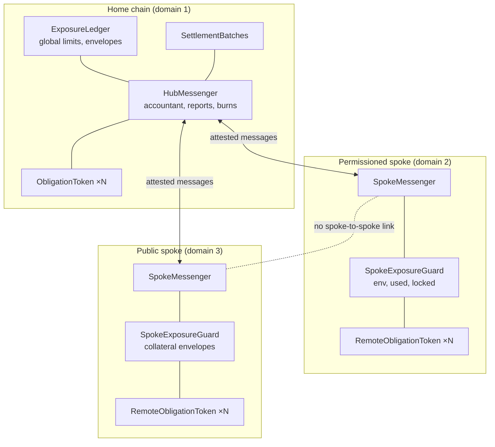

# Cross-chain design

The network's credit lives on one home chain. Members may also need their deposit tokens on other chains: a
permissioned chain shared with another network, or a public chain where their customers hold securities. This
document explains how the model reaches those chains without wrapped tokens, without giving any bridge or transport
the power to mint, and with every loss bounded in advance. Contract-level detail is in [design.md §4](design.md#4-cross-chain-spokes);
the step-by-step flows are in [business-flows.md §15](business-flows.md#15-cross-chain-flows).

## 1. Principles

| Principle | How the code applies it |
|---|---|
| One liability, issued natively | A token on a spoke is minted by that chain's `RemoteObligationToken` for its issuer, under the issuer's own key. Nothing on a spoke is a claim on tokens escrowed elsewhere |
| Two keys for every mint | A strict majority of the operator's attesters **and** the issuing bank's own key |
| Credit is allocated, never created | Spoke credit is an envelope reserved from the global limits at the hub before the spoke may use it |
| Restrict first, grant last | Anything that raises exposure happens at the hub first; anything that lowers it happens on the spoke first |
| Transports carry, never authorize | Any carrier may deliver a signed message; validity comes only from the signatures checked on the destination |
| Every failure is bounded | Envelopes, per-chain supply caps, an inbound mint rate limit and a global accountant cap what a lost or compromised spoke can cost |

## 2. Hub and spoke



Spokes talk only to the home chain: a `SpokeMessenger` accepts a remote only for the home domain and sends only
there (`SpokeToSpoke`). A move between two spokes is two moves through home. The hub keeps the global picture: every
spoke's envelopes count in the global exposure, and every spoke's settled positions enter the home batch.

Both messengers share one base contract, `CrossChainMessenger` (message format version 4, verification, lock-then-burn
bookkeeping, rate limits). `HubMessenger` and `SpokeMessenger` add what each side does with a message:

| Message kind | Value | Sent by | Effect at the destination |
|---|---|---|---|
| `MINT` | 0 | either side | A token move: mint to the holder's wallet (§5) |
| `MINT_ACK` | 1 | destination of a `MINT` | The source burns the locked tokens |
| `MINT_CANCEL` | 2 | destination of a `MINT` | The source unlocks the tokens |
| `ENVELOPE_GRANT` | 3 | hub | The spoke raises `env` |
| `ENVELOPE_RELEASE` | 4 | spoke | The hub lowers its reservation |
| `CUT` | 5 | hub | The spoke locks its open positions for the batch |
| `BATCH_LOCKED` | 6 | spoke | One per locked pair, then a terminator with zero ids carrying the pair count |
| `BURN_BATCH` | 7 | hub | The spoke burns a settled pair's locked tokens |
| `SUSPEND` | 8 | hub | The spoke pauses a member's token and cuts its envelopes to what is in use |

Each kind is accepted only in its own direction (`KindNotAccepted` otherwise).

## 3. Authority: who can make a message count

A message is the ABI encoding of an envelope `{version, kind, source, dest, nonce, member, counterparty, recipient,
amount, epoch, deadline, ref}`. The destination accepts it only if:

1. the version is 4 and `dest` is this chain;
2. a messenger is registered for `source`, and this `(source, nonce)` has never been accepted;
3. signatures from at least `threshold` attesters, each enabled, strictly ascending by address, recover from the
   digest `keccak256(tag, source messenger, destination messenger, keccak256(message))` (as an Ethereum signed
   message). The digest binds **both messenger addresses**, so a signature for one deployment cannot be replayed on
   another;
4. for a `MINT`, the issuing bank's own key (`issuerKey[member]`) also signed the same digest.

The attester threshold must be a **strict majority** of the enabled attesters and no more than their number
(`BadThreshold`); the deployment default is 3 of 5. No key may be both an attester and an issuer key
(`KeyHasOtherRole`). Governance changes attesters, threshold and issuer keys through the timelock; the guardian may
only disable an attester.

So neither the operator's attesters alone nor a bank alone can mint: an attacker needs a majority of the attester
keys and the issuer's key. Cancelling a move after its deadline (`cancelExpired`) needs only the attesters, because a
cancellation can only unlock what was locked.

## 4. Envelopes

A spoke cannot create credit. The operator grants each (issuer, holder) pair an envelope on a spoke, and the hub
reserves it from the global limits **before** the spoke may use it.

**The allocation invariant.** For every spoke `d`, issuer `i` and holder `h`, at every moment:

```
used[i][h] (on spoke d)  ≤  env[i][h] (on spoke d)  ≤  envelope[d][i][h] (at the hub)
```

and at the hub every envelope counts in the global exposure as if it were fully used:

```
gross(i, h) = open[i][h] + pending[i][h] + Σ_d envelope[d][i][h]
```

so every limit of the home chain holds whatever the spokes do within their envelopes. The order of operations keeps
the invariant true between messages, since messages arrive later:

| Operation | First | Then |
|---|---|---|
| Grant | Hub: `reserveEnvelope` runs the credit checks (permissioned) or commits collateral (public) and reserves | Spoke: `env` rises |
| Release | Spoke: `release` lowers parked headroom, then unused `env` | Hub: `releaseEnvelope` lowers the reservation |
| Spoke payment | Spoke: `used` rises within `env` (on a permissioned spoke, only in the business window, §4.1) | Nothing at the hub: already counted |
| Cut | Spoke: `used` and `env` both fall by the locked amount | Hub: `envelopeToPending` moves the same amount from the envelope into the batch (a public spoke's collateral stays committed until settlement, §9) |
| Suspend | Spoke: every envelope of the member is cut to `used`; the excess is parked as `releasable` | Hub: unchanged until the operator releases the parked amount |
| Move home → spoke | Hub: open position becomes envelope (`moveOut`) | Spoke: `env` and `used` rise together (`mintIn`) |
| Move spoke → home | Spoke: `env` and `used` fall together (`moveOut`) | Hub: envelope becomes open position (`moveIn`) |

A grant that reaches a spoke for an unknown or suspended pair raises nothing: it is parked as `releasable`
(`GrantParked` on the spoke messenger), and the operator hands it back. The cut consumes envelopes: once a pair's
position settles, the operator grants a new envelope if the pair still needs one.

### 4.1 The spoke window

The home chain allows no unsecured credit outside the business window. A permissioned spoke's envelope is credit,
so each spoke guard carries the same window (`SpokeExposureGuard.window`, `BUSINESS = 0`, `OFF_HOURS = 1`; a new
guard starts in `OFF_HOURS`). The operator sets it with `setWindow` (`OPERATOR_ROLE` on the spoke) at the same
boundaries as the home ledger: `BUSINESS` from 21:00 ET the evening before a business day to the end-of-day cut at
16:30 ET, `OFF_HOURS` otherwise (`Config.SpokeWindow` in the Go operator).

| Spoke kind | In `OFF_HOURS` |
|---|---|
| Permissioned | `pay` reverts `OffHoursCredit(payer, amount)`; `drain` mints nothing. There is no prefund allowance on a spoke: payments wait for the window |
| Public | Unaffected: every envelope is the issuer's collateral, so a payment there is not credit |

The window gates local payments only. Grants, releases, moves in either direction, cuts, burns and suspension work at
any hour. `TestXChain_X6_SpokeOffHours` shows a permissioned spoke refusing a payment at 16:31 ET while the public
spoke still pays, and the permissioned spoke reopening in the next business window.

## 5. Moves: lock, then burn

A holder may move tokens it holds between home and a spoke. The source never burns before the destination has
proven the mint, and the destination never mints twice.

```mermaid
sequenceDiagram
    autonumber
    participant W as Holder wallet (source)
    participant S as Source messenger
    participant A as Attesters + issuer key
    participant D as Destination messenger
    W->>S: sendMint(issuer, holder, amount, dest, recipient, deadline)
    Note over S: tokens LOCKED, move PENDING<br/>(exposure moves between open and envelope)
    S-->>A: MessageSent(MINT)
    A->>A: wait for source finality, sign
    A->>D: receiveMessage(MINT, attester sigs, issuer sig)
    alt checks pass and rate limit allows
        Note over D: inbound = MINTED, mint to recipient
        D-->>S: MINT_ACK (attested)
        Note over S: locked tokens BURNED, move COMPLETED
    else refused (unknown, suspended, wrong recipient, blocked, cap, accountant, envelope)
        Note over D: inbound = CANCELLED (final)
        D-->>S: MINT_CANCEL (attested)
        Note over S: tokens UNLOCKED, move CANCELLED
    else rate limit exhausted or unset
        Note over D: delivery reverts; the message stays deliverable
    end
    opt deadline passed, never minted
        A->>D: cancelExpired(MINT, attester sigs) (anyone may submit)
        Note over D: inbound = CANCELLED (final)
        D-->>S: MINT_CANCEL
    end
```

The timeout is a **proof from the destination**, not a clock at the source: the source unlocks only on a
`MINT_CANCEL` that the destination issued after marking the nonce cancelled for good. A destination nonce ends either
`MINTED` or `CANCELLED`, never both.

Refusal checks on each side:

| On the hub (spoke → home) | On a spoke (home → spoke) |
|---|---|
| issuer and holder known and distinct (`R_UNKNOWN`, 10) | issuer and holder known and distinct (`R_UNKNOWN`, 3) |
| recipient is the holder's home wallet (`R_RECIPIENT`, 11) | neither suspended on this spoke (`R_SUSPENDED`, 4) |
| token not paused, wallet not frozen (`R_BLOCKED`, 12) | recipient is the holder's wallet here (`R_RECIPIENT`, 6) |
| accountant: `returned + amount ≤ sent` (`R_ACCOUNTANT`, 13) | token not paused, wallet not frozen (`R_BLOCKED`, 5) |
| the spoke's envelope covers the amount (`R_ENVELOPE`, 7) | supply cap holds (`R_SUPPLY_CAP`, 2) |
| from a public spoke: credit checks (3)–(5) hold at home | |

On the home chain the escrow is the hub messenger itself (it holds `MOVER_ROLE` and `MESSENGER_ROLE` on the home
tokens); on a spoke the tokens are locked in the holder's wallet by the token contract (`lock`, `unlock`,
`burnLocked`). A locked balance cannot move; it leaves only by unlock or burn.

## 6. Bounds on a failed chain, transport or key set

Four independent limits apply on the **receiving** side, where a forged message would do its damage.

| Bound | Rule | Who changes it |
|---|---|---|
| **Envelope** | A spoke can only use headroom the hub reserved for it; losses on a spoke are bounded by its envelopes | Operator grants within the global limits |
| **Supply cap** | `supplyCap[issuer]` on each spoke: local payments and inbound mints stop at it | Governance raises (timelocked); guardian lowers |
| **Inbound mint rate limit** | A token bucket per (source domain, issuer) on the receiving chain: `capacity`, refilling at `capacity / window` (default window 1 hour). Every `MINT` spends it; burns never do. An exhausted bucket **reverts** the delivery, which can be retried later; it does not cancel the move. **A bucket that was never set has capacity 0, so the corridor is closed** | Governance sets or raises (the bucket starts full); guardian lowers capacity and level |
| **Global accountant** | At the hub, per (issuer, domain): `sent` (tokens locked at home for moves to that spoke, net of cancelled moves) and `returned` (tokens minted at home from that spoke). A spoke can never mint at home more than home sent it | Fixed rule |

The accountant also means that tokens created on a spoke by local payments cannot be moved home beyond what home has
previously sent to that spoke; such positions settle on the spoke through the normal cut (§7). The accountant's
`sent` falls only when a move is cancelled: settlement burns on a spoke do not reduce it, so over time it bounds
cumulative returns by cumulative sends rather than by what the spoke currently holds (see
[design.md §6](design.md#6-known-limits)).

If a spoke is lost, the guardian calls `HubMessenger.disconnectSpoke(domain)`: nothing more is accepted from it, and it
no longer holds up plans. Its envelopes stay reserved at the hub, so the most it can cost is what was granted to it.

## 7. Cut, lock, burn

Spoke positions settle in the same batch as home positions, with one fiat payment per net leg. The operator cuts
even when the home epoch is empty if a spoke holds open positions (`Config.OpenElsewhere`), so a day with payments
only on a spoke still settles that day.

1. `SettlementBatches.cut` calls `HubMessenger.broadcastCut(epoch)`, which sends `CUT` to every connected spoke and
   records that each was sent the cut.
2. Each spoke's guard locks every nonzero open pair (`used`) in the holder's wallet, takes it out of `used` and `env`,
   and sends one `BATCH_LOCKED` per pair, then a **terminator**: a `BATCH_LOCKED` with zero member ids whose amount is
   the number of pairs.
3. The hub moves each pair from the spoke's envelope into the batch's pending positions (`envelopeToPending`) and adds
   it to the batch's pair list (`addRemoteToBatch`, callable only by the messenger). A spoke's report is complete when
   the terminator has arrived and the count matches.
4. `submitPlan` reverts `SpokesNotReported` until every connected spoke that was sent the cut has reported in full,
   and the ledger refuses to seal the batch (`RemoteUnrecorded`) while any locked amount is not yet in the pair list.
   The Go operator treats `SpokesNotReported` as a wait, not an error, and submits the plan again once the reports
   are in.
5. The fiat legs are paid and attested as usual. `finalize` releases all exposure at the hub, releases the collateral
   still committed for public-spoke pairs, and burns the home pairs.
6. Anyone calls `HubMessenger.sendBurns(epoch)` once the batch is `COMPLETE`: one `BURN_BATCH` per spoke pair, once.
7. Each spoke burns exactly the locked amount for that epoch and pair (`BurnMismatch` otherwise). Until then the
   tokens are **settled-pending-burn**: locked, unusable, only burnable.

## 8. Suspension

`HubMessenger.sendSuspend(member)` sends `SUSPEND` to every connected spoke. Anyone may call it for a member not in
good standing at home; the guardian may call it for any member. On each spoke, `guard.suspend` pauses the member's
token, marks it suspended (no payments to or from it, no mints of its token or to it), and cuts every envelope it is party to, as
issuer or holder, down to what is in use, parking the rest as `releasable`. `SUSPEND` is restrict-only: it never
raises a limit or unpauses a token. Lifting it on a spoke is governance (`reinstate`), and envelopes return only by
new grants.

## 9. Public spokes: collateral only

On a spoke registered as `PUBLIC`, an envelope is drawn **one-for-one from the issuer's free collateral**
(`CollateralRegister.commitPublic`), not from credit limits; a move from home to a public spoke commits collateral in
the same way. Default credit on a public spoke is 0: with no envelope, nothing can be paid there. Because nothing on
a public spoke is credit, the spoke window (§4.1) does not apply there.

**The collateral is held for as long as the exposure exists.** A release, a cancelled move or a move landing home
frees it at once. An amount the public spoke locks at a cut keeps its collateral committed from the cut until the
batch finalizes: the hub records it per batch and pair (`ExposureLedger.remotePublicCommitted`) and releases it in
`clearPending`, when the pair settles. Until then the issuer cannot commit that collateral again, and the default
waterfall's collateral step draws only collateral that is not committed to public positions.

Why credit stays private:

- **Confidentiality.** Credit limits, positions and their changes reveal each bank's view of every other bank. On the
  home chain and on permissioned spokes only members and the operator see them. On a public chain every balance and
  every change would be visible to anyone. Collateral envelopes reveal only that a fully backed amount exists.
- **Containment.** A public chain is outside the members' control: its finality, its validators and its other
  applications are not governed by the rulebook. A loss on a public spoke must not become a credit loss for the
  network; with collateral envelopes the receiving bank is covered one-for-one by the issuer's own collateral.
- **Supervisory fit.** The regulatory treatment of exposure, collateral and default
  assumes a closed set of members. Keeping credit off public chains keeps that analysis intact.

A public spoke still serves the main use case: delivery versus payment against assets that live there (the
scenario in [business-flows.md §15.4](business-flows.md#154-a-dvp-like-payment-on-a-public-spoke)). When a public
spoke's position moves home, the hub re-checks the home credit limits before minting (`moveInCheck`).

## 10. Finality per chain

Attesters and issuers sign a message only after the **source chain's finality**, each reading the source from a node
it runs itself. That is an operational rule: no contract can verify which node a signer used. The rule matters
because a signer that trusts someone else's node can be fed a forged chain (§12, Kelp DAO).

| Chain | What "final" means for signing |
|---|---|
| Home chain and permissioned spokes | The chain's own deterministic (BFT-style) finality: a committed block is final, so no extra depth is needed |
| Public spoke | A finality depth configured per chain in the attesters' runbook. Where the chain publishes finality checkpoints, the depth should reach the finalized checkpoint, not a short confirmation count |

A move's deadline must leave room for source finality, signing and delivery; a move that misses it is cancelled by
proof (§5), never lost.

A cross-chain move is not settlement. The interbank settlement point stays the fiat leg over CHIPS or RTP; a token
move only changes the ledger on which the same liability is recorded, and its in-flight state (locked at the source,
not yet minted) is defined above and counted in the exposure throughout.

## 11. Transports

The contracts do not care how a message travels. `MessageSent` carries the full encoded message; anyone may submit it
with its signatures to `receiveMessage` on the destination. A third-party messaging network, a relayer run by the
operator, or a member's own process can all carry it. None can make it valid: validity comes only from the attester
majority and, for a mint, the issuer's key, checked on the destination. A transport outage delays messages; a transport cannot
forge them, and cannot replay them (`NonceUsed`).

The model's own transport is `internal/xchain`: five attesters in the tests, each on its own connections and signing
only up to each chain's final head; one issuer co-signer per bank, which co-signs a `MINT` of its own token only
when its own node shows the matching lock, final, at the source; and an untrusted relayer that delivers in
`(source, nonce)` order, skips nonces already consumed, retries a `RateLimited` delivery later and cancels an expired
`MINT` with `cancelExpired`. `xchain.Reconcile` checks supply and envelope nesting across every chain. Six end-to-end
tests run it on three anvil chains (home, permissioned spoke, public spoke): a cut across chains (X1), lock-then-burn
moves (X2), faults (X3), suspension (X4), a spoke-only day (X5) and the spoke window (X6).

## 12. Incident lessons

Loss figures are from the cited secondary write-ups, not from official post-mortems.

| Incident | What happened | The control here |
|---|---|---|
| **Kelp DAO, April 2026** (about $292M) | A bridge configured with a single verifier; the attacker poisoned that verifier's RPC nodes and knocked out the clean ones, so a forged "burned elsewhere" message released escrowed tokens. No inbound limit was configured ([rekt](https://rekt.news/kelpdao-rekt)) | Two keys (attester majority and issuer key), each signer reading its own node; an inbound rate limit on the receiving chain; the accountant refuses mints at home beyond what home sent; no escrow on spokes to release |
| **Ronin, March 2022** (about $625M) | Attackers held 5 of 9 validator keys, one through a delegation never revoked ([write-up](https://cryptohawking.com/blog/ronin-bridge-validator-key-compromise)) | The issuer key is needed in addition to the attester majority; attester and issuer keys can never be the same; key changes only through the timelock; the guardian can disable an attester at once |
| **Ronin, August 2024** (about $12M) | A faulty upgrade misread the vote threshold; a withdrawal limit capped the loss ([CoinDesk](https://coindesk.com/tech/2024/08/06/ronin-bridge-paused-after-9m-drained-in-apparent-whitehat-hack)) | The threshold rule is checked on every change (strict majority, never above the attester count); supply caps and the inbound rate limit bound any single failure |
| **Wormhole, February 2022** (about $326M) | A signature-verification bypass minted 120,000 wETH against nothing ([write-up](https://www.zircuit.com/blog/the-bridge-hacks-that-exposed-cross-chain-finances-fatal-flaws)) | One verification path for every message; signatures must recover to enabled keys, strictly ascending; the accountant and supply caps hold even if verification were bypassed |
| **Nomad, August 2022** (about $190M) | A faulty initialization let any message pass, and attackers replayed a valid transaction with the recipient changed ([write-up](https://smartcontractauditor.ai/blog/nomad-bridge-hack-analysis-190m-in-2022)) | A message is valid only with fresh signatures over its exact bytes, bound to both messengers; each `(source, nonce)` once; the recipient must be the holder's own wallet |
| **Hyperbridge, April 2026** | A forged message minted a billion bridged tokens; only shallow liquidity limited the realized loss ([write-up](https://1inch.com/blog/post/the-biggest-bridge-hacks-in-2026)) | A per-chain supply cap at the mint contract, and the inbound rate limit, bound any single mint |

The common lesson is that limits must sit where the mint happens, on the receiving chain, and must not depend on the
same keys or data sources that verify the message.

## 13. Known limits

See [design.md §6](design.md#6-known-limits): a disconnected spoke's in-flight moves and envelopes are stranded
(bounded by its envelopes); the accountant's `sent` count only grows except on cancellation; one batch is in flight
at a time; the cover-2 pool requirement is attested, not computed on chain; the spoke window is a direct operator
transaction on each spoke, so a spoke the operator cannot reach keeps its last window; and the batch's epoch hash
covers the home chain only.
